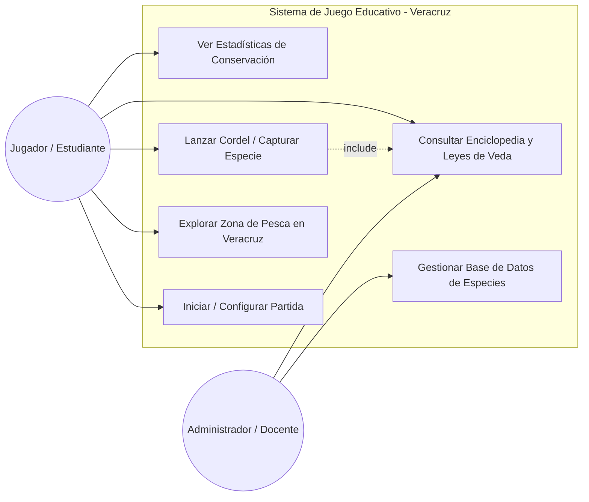
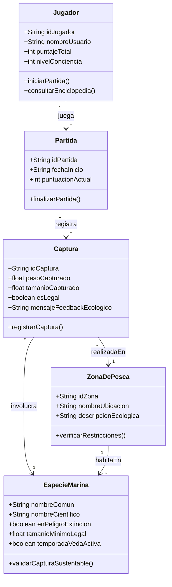

# Documentación del Proyecto Integrador: Veracruz Oddysee

## 1. Introducción
Este documento presenta el modelado UML (Casos de Uso y Diagramas de Clases) para el desarrollo del videojuego educativo enfocado en la conservación ambiental y la pesca sustentable en el estado de Veracruz.

## 2. Diagrama de Casos de Uso General
El diagrama general describe los flujos interactivos entre el usuario estudiante, el sistema y las reglas de concientización ambiental implementadas.

## 3. Diagrama de Clases del Módulo Principal
El diagrama de clases detalla la estructura orientada a objetos para gestionar las reglas de veda, tallas mínimas, zonas protegidas y el progreso del jugador.

## 4. Herramientas Utilizadas
- **Mermaid:** Modelado colaborativo integrado directamente en Markdown y control de versiones en GitHub.
